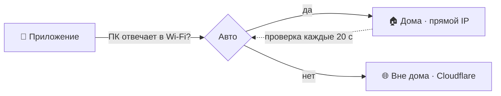

# ⚡ Пульт ПК · PhoneV2

**Управляй Windows-компьютером с телефона — дома по Wi-Fi и из любой точки мира**

[⬇️ **Скачать APK**](https://github.com/Fersiya/PhoneV2/releases/latest) · [🖥️ Сервер для ПК](https://github.com/Fersiya/PhoneV2-server)

---

## ✨ Возможности

| | |
|---|---|
| 🖥️ **Экран** | Трансляция до 60 FPS (3 пресета: ⚡ Турбо, ⚖️ Баланс, 🔍 FHD), зум, полноэкранный режим, мышь как тачпад |
| 🎵 **Медиа** | Громкость, плеер, пульт YouTube |
| 🪟 **Окна и софт** | Запуск и закрытие программ, переключение окон |
| ⚡ **Питание** | Выключить, сон, рестарт, **таймер выбирается прямо в диалоге**, Wake-on-LAN, CPU / RAM / диски |
| 📁 **Файлы** | Проводник ПК, скачивание на телефон, автозагрузка новых фото на ПК |
| 🌐 **Два режима связи** | 🏠 дома (Wi-Fi) и 🌐 вне дома (Cloudflare) — переключаются сами, **без Tailscale** |
| 🎨 **Темы** | Кибер, Закат, Лес, Океан, Виноград, Светлая |
| 🔄 **Обновления** | По воздуху (OTA) с ПК, а на GitHub каждая сборка выходит релизом |

## 🚀 Установка за 3 шага

1. 🖥️ Скачай и установи на ПК [**PCControl-Setup.exe**](https://github.com/Fersiya/PhoneV2-server/releases/latest) — ничего больше не нужно.
2. 📱 Скачай [последний APK](https://github.com/Fersiya/PhoneV2/releases/latest) и установи.
3. 📶 Подключи телефон к той же Wi-Fi сети → **Опции → «🔍 Найти ПК в Wi-Fi»** (окно «Пульт ПК» на компьютере должно быть открыто). Адрес и токен подставятся сами.

> 💡 Для работы вне дома достаточно один раз открыть приложение дома: оно запомнит интернет-адрес ПК.

## 🧭 Режимы подключения

| Режим | Когда | Адрес |
|---|---|---|
| 🔄 **Авто** | всегда | выбирает сам, возвращается домой без вашего участия |
| 🏠 **Дома** | только Wi-Fi | IP ПК, например `192.168.0.10` |
| 🌐 **Вне дома** | только интернет | `https://….trycloudflare.com` (берётся автоматически) |

Что-то не работает? **Опции → 🩺 Диагностика связи**: она проверит оба маршрута и подскажет, что не так (VPN, остановленный туннель, неверный токен).

## 🔐 Безопасность

- 🔑 Доступ по секретному токену, после 10 ошибок IP блокируется на 15 минут.
- 🤝 Токен по кнопке выдаётся **только в домашней сети** — через туннель его получить нельзя.
- 🔒 Подпись APK — собственный ключ (GitHub Secrets), поэтому обновления ставятся поверх.
- ⚠️ Не пробрасывай порт `8765` на роутере: для внешнего доступа есть туннель (HTTPS).

## 🛠️ Сборка

Каждый push в `main` собирает подписанный APK и публикует его в [Releases](https://github.com/Fersiya/PhoneV2/releases). Подробности и настройка ключа — в [BUILD.md](BUILD.md).

📂 Структура кода

| Файл | Назначение |
|---|---|
| `Theme.kt` | цветовые схемы и выбор темы |
| `Models.kt` | модели данных, вкладки |
| `Parsers.kt` | парсинг JSON, адреса, геометрия трансляции |
| `Network.kt` | HTTP/UDP, MJPEG-декодер, Wake-on-LAN, туннель |
| `Components.kt` | кнопки, тач-элементы, счётчик FPS |
| `PcControlMainApp.kt` | экраны и логика приложения |
| `PcControlTileService.kt` | плитка быстрых настроек (Wake-on-LAN) |

Тесты: `gradle test`.

## 🔄 Синхронизация

`sync_github.bat` делает commit → `git pull --rebase` → push. Принудительный push не используется.
